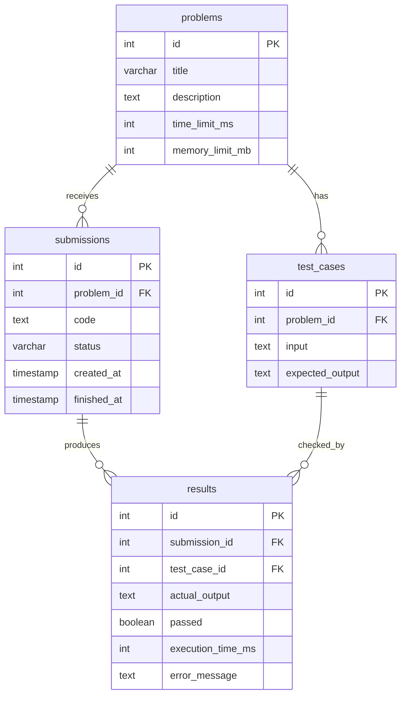

## Database (Student 2: Chayma)

### Overview
PostgreSQL 16 stores the problems, their test cases, the submitted code and the results of each execution.

### ER diagram


### Tables
| Table | Purpose |
|---|---|
| problems | Exercises users can solve |
| test_cases | Input and expected output for each problem |
| submissions | Submitted code and its global status |
| results | Outcome of each test case for each submission |

Submission status: `pending` -> `running` -> `passed`, `failed`, `error` or `timeout`.

### Start the database locally
```bash
cp .env.example .env
docker compose -f docker-compose.db.yml up -d
```
The scripts in `db/init/` run automatically the first time and create the tables and seed data.

### Persistence
Data is stored in the Docker volume `pgdata` and survives `docker compose down`. To reset the database completely: `docker compose -f docker-compose.db.yml down -v`.# code-evaluation-platform